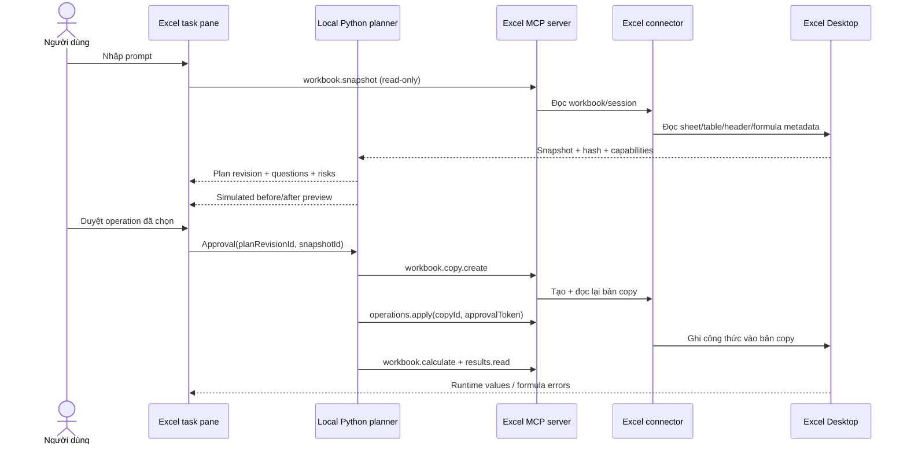

# Đặc tả tích hợp Excel trực tiếp qua MCP

> Quyết định bổ sung 04/10/2026: người dùng đồng ý dùng Codex online cho ô prompt Excel. Khi bấm Phân tích, panel được gửi prompt và tối đa 20 dòng × 200 cột cho mỗi sheet/table tới OpenAI qua Codex; không gửi workbook binary hoặc đường dẫn local. Quyết định này thay thế EX-D-002 và mục cấm cloud AI bên dưới trong phạm vi hẹp này. Proposal của Codex hiện read-only; chưa có generic preview-after hoặc apply nên không được đánh dấu W-23/GX3 hoàn tất.

| Thuộc tính | Giá trị |
|---|---|
| Phiên bản | 0.1 |
| Ngày | 03/10/2026 |
| Trạng thái | Draft để triển khai spike và prototype; chưa có Excel MCP runtime |
| Phạm vi | Excel Desktop trên Windows, task pane, planner cục bộ, workbook nguồn chỉ đọc |
| Tài liệu cha | `SPEC.md` v0.6, `IMPLEMENTATION_PLAN.md` |
| Chủ sở hữu nghiệp vụ | Người khởi xướng dự án; tên chính thức chưa được chỉ định |
| Người soạn | Codex theo yêu cầu người dùng |
| Người review/phê duyệt | Product owner và kỹ thuật Excel connector; đang chờ chỉ định |
| Trạng thái phê duyệt | Chưa phê duyệt production; được dùng làm baseline cho W-21 spike |

### Lịch sử thay đổi

| Phiên bản | Ngày | Thay đổi |
|---|---|---|
| 0.1 | 03/10/2026 | Tạo scope, architecture, MCP tool contract, FR, error catalog, fixture, 28 test scenario và exit gate. |
| 0.1a | 04/10/2026 | Khóa traceability FR–AC–W–test và nghiệm thu fixture bằng 4 unit test; chưa thay đổi product scope. |

## 1. Mục tiêu

Cho phép người dùng mở một workbook trong Excel, nhập yêu cầu bằng tiếng Việt hoặc tiếng Anh trong side-panel, xem kế hoạch và preview trước/sau, rồi chủ động phê duyệt để hệ thống tạo một bản copy và chỉ ghi công thức/thay đổi vào bản copy đó.

Kết quả thử nghiệm đầu tiên phải chứng minh được chuỗi sau trên dữ liệu tổng hợp:

```text
Workbook đang mở → snapshot chỉ đọc → prompt → kế hoạch có kiểu
→ static validation → preview mô phỏng → user approval
→ tạo và kiểm tra bản copy → apply qua Excel connector
→ Excel calculate → đọc lại kết quả runtime
```

Không được coi preview Python/JavaScript là bằng chứng Excel đã tính đúng. Chỉ kết quả đọc lại sau `Excel.Calculate` trên bản copy mới có trạng thái `Excel runtime verified`.

## 2. Quyết định kiến trúc và giới hạn

### 2.1 Quyết định đã chốt

| ID | Quyết định |
|---|---|
| EX-D-001 | Giao diện là Excel task pane. Bản thử nghiệm chỉ nhắm Excel Desktop trên Windows. |
| EX-D-002 | Prompt, metadata và mẫu dữ liệu chỉ đi qua tiến trình cục bộ; không gọi AI cloud. |
| EX-D-003 | Workbook đang mở là nguồn chỉ đọc. Mọi thao tác ghi phải nhắm một bản copy có `copyId`, đường dẫn và hash riêng. |
| EX-D-004 | MCP là hợp đồng tool giữa planner và Excel connector; MCP không tự thay thế Excel executor. |
| EX-D-005 | Python standard library giữ vai trò coordinator/planner. Connector thật nằm sau một interface để unit test bằng fake connector. |
| EX-D-006 | User approval gắn với `workbookSnapshotId`, `planRevisionId` và tập `operationIds`; đổi bất kỳ thành phần nào làm approval hết hiệu lực. |
| EX-D-007 | Static preview phải mang nhãn `Simulated preview`. Trạng thái runtime chỉ được cấp sau khi Excel tính lại và hệ thống đọc lại ô kết quả. |

### 2.2 Kiến trúc mục tiêu



### 2.3 Connector spike bắt buộc

Không khóa production executor trước khi spike. Hai phương án phải được đo bằng cùng contract test:

| Phương án | Vai trò | Điểm phải chứng minh |
|---|---|---|
| Office.js | UI task pane và thao tác workbook qua Excel object model | Đọc table/range, ghi `Range.formulas`, calculate, nhận diện workbook/session; localhost HTTPS và sideload hoạt động |
| Windows desktop bridge | Tạo/save bản copy và điều khiển Excel Desktop cục bộ | Không ghi nguồn, chọn đúng workbook, xử lý workbook chưa lưu/đang khóa, timeout COM, Excel process lifecycle |

Baseline đề xuất cho prototype là **Office.js cho task pane và workbook object model**, cộng một **local Windows helper chỉ cho bước tạo bản copy** nếu Office.js không cung cấp đủ đường dẫn/save-copy cho workbook local. Mọi phụ thuộc mới phải được ghi lại sau spike; chưa được đưa vào runtime chính chỉ dựa trên giả định.

## 3. Phạm vi

### Trong phạm vi prototype

- Kết nối side-panel với workbook đang mở và hiển thị tên workbook/sheet active.
- Đọc metadata workbook, worksheet, Excel table, used range, header và tối đa 20 dòng preview.
- Nhận prompt tối đa 4.000 ký tự; lưu nguyên văn cục bộ như yêu cầu/hypothesis.
- Sinh plan revision có mục tiêu, giả định, bằng chứng, operation có kiểu, dependency, warning và hard blocker.
- Catalog thao tác đầu tiên:
  - `excel.formula_column.add`
  - `excel.summary_formula.add`
  - `excel.number_format.set`
  - `excel.column.description.set` nếu API mục tiêu hỗ trợ; nếu không, trả `unsupported`.
- Preview trước/sau bằng dữ liệu giới hạn; không tạo hoặc sửa workbook ở bước preview.
- User chọn operation và phê duyệt tường minh.
- Tạo bản copy, xác minh copy đọc được và hash nguồn không đổi trước khi apply.
- Ghi formula/format vào bản copy, yêu cầu Excel calculate, đọc lại formula/value/error.
- Hiển thị trạng thái và audit metadata mà không log raw cell value.

### Ngoài phạm vi prototype

- Ghi trực tiếp vào workbook nguồn hoặc tự động lưu đè workbook đang mở.
- Macro/VBA, `.xls`, `.xlsm`, workbook mã hóa, external credentials và Protected View bypass.
- Arbitrary Python/PowerShell/code do prompt sinh ra.
- Gửi workbook/prompt lên cloud AI.
- Chứng minh logic nghiệp vụ đúng khi người dùng chưa xác nhận định nghĩa KPI.
- Power BI/PBIP trong lát cắt Excel MCP đầu tiên.
- Nhiều người dùng hoặc điều khiển Excel từ máy khác.

## 4. Actor và quyền

| Actor | Trách nhiệm | Quyền |
|---|---|---|
| Excel Analyst | Mở workbook, nhập prompt, sửa yêu cầu, chọn operation, duyệt | Đọc nguồn; cho phép tạo/ghi bản copy |
| Local Planner | Phân tích snapshot và prompt, sinh plan/preview | Không tự phê duyệt; không ghi workbook |
| Excel MCP Server | Công bố tool có schema và điều phối connector | Tool ghi chỉ chạy với approval token hợp lệ |
| Excel Connector | Thực thi lệnh đọc/copy/apply/calculate | Không nhận arbitrary script; chỉ operation allowlist |
| Excel Desktop | Tính công thức và cung cấp runtime result | Chỉ bản copy được dùng cho write flow |

## 5. Luồng chức năng

### EX-UC-001 — Phân tích prompt và preview

**Tiền điều kiện:** Excel Desktop đang mở một workbook `.xlsx` đã lưu; task pane kết nối được local coordinator.

1. Task pane tạo session nonce và yêu cầu connector mô tả workbook active.
2. Connector đọc workbook/sheet/table/header theo chế độ read-only và trả capability matrix.
3. Coordinator tạo `WorkbookSnapshot` gồm workbook identity, file hash, sheet/table inventory và timestamp.
4. Người dùng nhập prompt.
5. Planner phân loại từng câu thành yêu cầu đã đủ căn cứ, giả thuyết hoặc câu hỏi cần xác nhận.
6. Planner tạo `PlanRevision` và các operation có kiểu.
7. Rule engine kiểm tra cột/sheet tồn tại, công thức không ghi ngoài target, dependency đầy đủ và không có source-write.
8. Hệ thống tạo `Simulated preview` tối đa 20 dòng, kèm công thức dự kiến và giới hạn kết luận.
9. Nếu có hard blocker, nút duyệt bị khóa. Nếu cần làm rõ nghiệp vụ, người dùng sửa prompt hoặc cung cấp câu trả lời để tạo revision mới.

### EX-UC-002 — Duyệt và apply vào bản copy

**Tiền điều kiện:** Plan revision ở `review_ready`, static validation pass và snapshot còn hiện hành.

1. Người dùng chọn operation và bấm `Duyệt và tạo bản copy`.
2. Coordinator tạo `ApprovalDecision` cho đúng snapshot/revision/operation.
3. Connector kiểm tra lại workbook identity/hash và trạng thái saved/locked.
4. Connector tạo bản copy theo tên không ghi đè, đọc lại file và trả `copyId`.
5. Coordinator chỉ định operations đã duyệt cho `copyId`; mọi target nguồn bị hard-block.
6. Connector ghi công thức/format, calculate workbook và đọc lại target range.
7. Hệ thống đối chiếu row count, formula text, error cells và số kiểm soát trong manifest test.
8. Thành công: `Applied — Excel runtime verified`. Lỗi tính toán: `Applied — runtime failed`, giữ bản copy và hiển thị target/error/remedy.

### EX-UC-003 — Thay đổi sau preview

- Prompt, workbook, target range, operation selection hoặc business rule thay đổi → approval cũ `invalidated`.
- Workbook hash khác snapshot → `SOURCE_CHANGED`, không tạo/apply bản copy từ plan cũ.
- Connector mất kết nối → giữ plan ở local state, không suy diễn apply thành công.

## 6. Yêu cầu chức năng

| ID | Ưu tiên | Yêu cầu kiểm thử được | Test |
|---|---|---|---|
| EX-FR-001 | Must | Task pane phải bind với đúng Excel session/workbook và hiển thị workbook, active sheet, trạng thái saved/read-only. | EX-T-01/02 |
| EX-FR-002 | Must | `workbook.snapshot` phải trả identity, hash, sheet/table/header, used range, formula metadata và capability matrix mà không ghi workbook. | EX-T-03/04 |
| EX-FR-003 | Must | Preview dữ liệu phải opt-in, tối đa 20 dòng trên UI và không ghi raw cell vào log/audit. | EX-T-05/24 |
| EX-FR-004 | Must | Prompt phải được xử lý cục bộ, tối đa 4.000 ký tự, lưu nguyên văn với trạng thái `hypothesis` hoặc `business_rule`. | EX-T-06/07 |
| EX-FR-005 | Must | Planner phải tạo plan revision có evidence, assumptions, risks, confidence, operations và questions. | EX-T-08 |
| EX-FR-006 | Must | Mỗi operation phải có `id`, `type`, `target`, `payload`, `dependsOn`, `reason`, `risk` và `sourceEvidence`. | EX-T-09 |
| EX-FR-007 | Must | Không được tạo operation dùng cột/sheet không tồn tại; hệ thống phải trả mã lỗi và câu hỏi cần bổ sung. | EX-T-10 |
| EX-FR-008 | Must | Preview trước/sau phải được tạo mà không có write call và mang nhãn `Simulated preview`. | EX-T-11/12 |
| EX-FR-009 | Must | Approval phải gắn đúng snapshot/revision/operations; mọi thay đổi liên quan làm approval hết hiệu lực. | EX-T-13/14 |
| EX-FR-010 | Must | Tool ghi phải từ chối yêu cầu thiếu/khác approval token hoặc nhắm workbook nguồn. | EX-T-15/16 |
| EX-FR-011 | Must | Hệ thống phải tạo bản copy không ghi đè, xác minh đọc lại được, ghi hash/size trước khi apply. | EX-T-17/18 |
| EX-FR-012 | Must | Connector chỉ được thực thi operation allowlist; không nhận arbitrary script hoặc free-form file path. | EX-T-19 |
| EX-FR-013 | Must | Sau apply, Excel phải calculate và connector đọc lại formula/value/error từ target range. | EX-T-20 |
| EX-FR-014 | Must | Static preview và Excel runtime result phải là hai trạng thái khác nhau, không tự nâng `verified`. | EX-T-21 |
| EX-FR-015 | Must | Lỗi hard block phải có code, target, reason, remedy và không có thao tác override. | EX-T-22 |
| EX-FR-016 | Must | Reset/close session phải xóa token, prompt state tạm và snapshot preview; không xóa workbook/copy đã tạo. | EX-T-23 |
| EX-FR-017 | Should | Connector phải trả progress/cancellation cho snapshot/apply trên workbook lớn. | EX-T-25 |
| EX-FR-018 | Should | Nếu AI cục bộ không khả dụng, deterministic fake/rule planner vẫn chạy được bộ demo đã định nghĩa. | EX-T-26 |

## 7. Hợp đồng MCP v0

Tên tool là baseline để viết contract test; spike được phép đổi tên một lần trước khi khóa v1.

| Tool | Read/Write | Input tối thiểu | Output tối thiểu | Hard gate |
|---|---|---|---|---|
| `excel.session.describe` | Read | `sessionNonce` | connector/excel version, active workbook identity, capabilities | Không có Excel session |
| `excel.workbook.snapshot` | Read | `sessionNonce`, preview policy | `snapshotId`, hash, sheets, tables, headers, bounded preview | Workbook unsaved/encrypted/unsupported |
| `excel.range.read` | Read | `snapshotId`, target, maxRows/maxCols | formula/value/type/error metadata | Target ngoài used range hoặc quá limit |
| `excel.copy.create` | Write-copy | `snapshotId`, destination policy, approval token | `copyId`, path label, hash, read-back status | Hash đổi, destination unsafe, copy fail |
| `excel.operations.apply` | Write-copy | `copyId`, `planRevisionId`, operations, approval token | operation result, changed ranges | Target là source, token mismatch, unsupported operation |
| `excel.workbook.calculate` | Write-copy | `copyId`, mode, timeout | calc state, duration | Không đúng copy/session |
| `excel.results.read` | Read-copy | `copyId`, operation targets | formula/value/error/reconciliation | Target mismatch |

Mọi tool response có envelope:

```json
{
  "correlationId": "...",
  "status": "ok|warning|blocked|failed",
  "data": {},
  "errors": [{"code": "...", "target": "...", "reason": "...", "remedy": "..."}]
}
```

Tool server không log `data` chứa cell values. Audit chỉ ghi correlation ID, hash, range address, row/column count, operation ID và trạng thái.

## 8. Mô hình dữ liệu trạng thái

| Entity | Trường chính |
|---|---|
| `ExcelSession` | `sessionId`, `nonce`, `excelPid/instanceHint`, `connectorVersion`, `capabilities`, `createdAt` |
| `WorkbookSnapshot` | `snapshotId`, `sessionId`, `workbookIdentity`, `sourceHash`, `sheets`, `tables`, `createdAt` |
| `PromptRequest` | `requestId`, `text`, `classification`, `createdAt` |
| `PlanRevision` | `revisionId`, `snapshotId`, `requestId`, `operations`, `questions`, `risks`, `validation` |
| `ApprovalDecision` | `approvalId`, `revisionId`, `snapshotId`, `selectedOperationIds`, `actor`, `approvedAt` |
| `WorkbookCopy` | `copyId`, `sourceSnapshotId`, `pathLabel`, `beforeHash`, `afterHash`, `createdAt` |
| `RuntimeEvidence` | `evidenceId`, `copyId`, `operationIds`, `calculationState`, `targets`, `errors`, `verifiedAt` |

Trạng thái chính:

```text
session_ready → snapshot_ready → plan_draft
→ needs_clarification | review_ready
→ approved → copy_ready → applying
→ applied_pending_calculation
→ excel_runtime_verified | runtime_failed
```

## 9. Error catalog bắt buộc

| Code | Loại | Ý nghĩa | Hành vi |
|---|---|---|---|
| `EXCEL_NOT_CONNECTED` | Hard block | Không có Excel session | Khóa snapshot/apply; hướng dẫn mở Excel/add-in |
| `WORKBOOK_UNSAVED` | Hard block cho copy | Workbook chưa có bản lưu ổn định | Yêu cầu Save trước khi lập snapshot |
| `SOURCE_CHANGED` | Hard block | Hash/identity khác snapshot | Hủy approval, tạo snapshot/preview mới |
| `SOURCE_WRITE_FORBIDDEN` | Hard block | Target trỏ workbook nguồn | Không cho override |
| `COPY_CREATE_FAILED` | Hard block | Không tạo/đọc lại được bản copy | Không apply |
| `APPROVAL_MISMATCH` | Hard block | Token không khớp revision/snapshot/operation | Yêu cầu duyệt lại |
| `TARGET_NOT_FOUND` | Hard block | Sheet/table/column/range không tồn tại | Hiện target và sửa mapping |
| `UNSUPPORTED_OPERATION` | Hard block | Operation không thuộc allowlist | Không chuyển thành script tự do |
| `SHEET_PROTECTED` | Hard block | Target không ghi được | Yêu cầu người dùng xử lý protection hợp lệ |
| `FORMULA_RUNTIME_ERROR` | Runtime failed | Excel trả `#VALUE!`, `#N/A`, `#REF!`... | Giữ copy, chỉ rõ range và formula |
| `CALCULATION_TIMEOUT` | Runtime failed | Excel không hoàn tất trong ngưỡng | Giữ copy; cho phép retry calculate, không retry apply |
| `CONNECTOR_DISCONNECTED` | Failed | Mất bridge giữa chừng | Không suy diễn trạng thái; đối chiếu audit khi reconnect |

## 10. Fixture và prompt nghiệm thu

Fixture tổng hợp được tạo bởi `examples/excel_mcp_fixtures.py` tại `tests/fixtures/excel/`:

- `excel_mcp_sales_input.xlsx`
  - `Sales` / `SalesTable`: 6 dòng, 9 cột nguồn.
  - `Dim_Commission` / `CommissionTable`: ngưỡng doanh thu và tỷ lệ hoa hồng.
  - Không có formula trong workbook nguồn.
- `manifest.json`
  - SHA-256 và row count kỳ vọng.
  - Prompt chuẩn, business rules, operation kỳ vọng.
  - Kết quả kiểm soát cho Net Revenue, Return Rate, Commission Value và Sales Rank.

Prompt chuẩn:

```text
Trong SalesTable:
1. Tạo Net Revenue = Gross Revenue - Discount Value - Return Value.
2. Tạo Return Rate = Total Return Qty / Total Sold Qty; nếu mẫu số bằng 0 thì trả 0.
3. Tạo Commission Value bằng XLOOKUP gần đúng theo Min Net Revenue ở Dim_Commission.
4. Xếp Sales Rank theo Net Revenue: percentile >= 90% là Top 10%, >= 80% là Top 20%, còn lại là Bottom.
```

Kết quả kỳ vọng không được hiểu là dữ liệu kinh doanh thật. Nó chỉ là oracle cho fixture tổng hợp.

## 11. Ma trận test và điều kiện đạt

| ID | Cấp | Tình huống | Kết quả đạt |
|---|---|---|---|
| EX-T-01 | Integration | Mở fixture và task pane | Bind đúng workbook active |
| EX-T-02 | Negative | Hai workbook cùng tên | Dùng session/identity; không chọn nhầm |
| EX-T-03 | Contract | Snapshot fixture | Đúng 2 sheet, 2 table, header/range/hash |
| EX-T-04 | Negative | Workbook mã hóa/không hỗ trợ | Hard block, 0 write |
| EX-T-05 | Security | Preview 6 dòng | Không vượt limit; không log cell values |
| EX-T-06 | Unit | Prompt chuẩn | 4 operation đúng thứ tự/dependency |
| EX-T-07 | Boundary | Prompt > 4.000 ký tự | Validation error, không gọi connector |
| EX-T-08 | Unit | Plan schema | Đủ evidence/assumption/risk/confidence/questions |
| EX-T-09 | Contract | Typed operation | JSON schema pass; không có free-form script |
| EX-T-10 | Negative | Thiếu `Dim_Commission` | `TARGET_NOT_FOUND`; không tạo commission formula |
| EX-T-11 | Unit | Simulated preview | 6 output khớp manifest trong sai số đã định |
| EX-T-12 | Spy connector | Preview | Số write call = 0 |
| EX-T-13 | Unit | Duyệt đúng revision | Approval hợp lệ cho đúng operation |
| EX-T-14 | Negative | Sửa prompt sau duyệt | Approval `invalidated` |
| EX-T-15 | Security | Apply thiếu token | `APPROVAL_MISMATCH`, 0 write |
| EX-T-16 | Security | Apply target nguồn | `SOURCE_WRITE_FORBIDDEN`, không override |
| EX-T-17 | Integration | Create copy | Copy tồn tại, đọc lại được, source byte-identical |
| EX-T-18 | Negative | Destination đã tồn tại/không ghi được | Không overwrite; `COPY_CREATE_FAILED` |
| EX-T-19 | Security | Operation `excel.script.run` | `UNSUPPORTED_OPERATION` |
| EX-T-20 | Excel runtime | Apply 4 công thức + calculate | Formula/value đọc lại khớp manifest |
| EX-T-21 | UI | Trước và sau calculate | Nhãn `Simulated` khác `Excel runtime verified` |
| EX-T-22 | UI negative | Hard blocker | Hiện code/target/reason/remedy; nút duyệt/apply khóa |
| EX-T-23 | Unit | Reset session | Token/state tạm xóa; source và copy không bị xóa |
| EX-T-24 | Security | Capture log | Không có prompt raw/cell raw/workbook binary/token |
| EX-T-25 | Performance | 100k dòng | Có progress/cancel; ngưỡng đo được ghi lại, chưa tự tuyên bố đạt |
| EX-T-26 | Resilience | Local AI unavailable | Fake deterministic vẫn tạo đúng plan fixture |
| EX-T-27 | Failure injection | Connector ngắt sau 2/4 operation | Không ghi nguồn; copy gắn `partial_apply`, có changed-range audit |
| EX-T-28 | Runtime negative | XLOOKUP không được hỗ trợ ở Excel version thử | Capability gate trước apply hoặc runtime error có remedy |

### Exit gate prototype

Prototype chỉ được nghiệm thu khi:

1. Toàn bộ unit/contract tests dùng fake connector xanh.
2. EX-T-01, 03, 06, 11, 13, 15–21, 24 và 27 xanh trên một máy Windows test được ghi phiên bản Excel.
3. Hash workbook nguồn trước/sau giống nhau 100%.
4. Không có tool write nào chạy trước approval.
5. Workbook copy mở được trong Excel và bốn cột kết quả khớp manifest.
6. Báo cáo ghi rõ connector/version, Excel build, test nào manual và test nào automated.

## 12. Rủi ro, giả định và câu hỏi mở

| ID | Loại | Nội dung | Xử lý |
|---|---|---|---|
| EX-R-001 | Rủi ro | Office.js task pane cần HTTPS local và môi trường sideload/certificate. | W-21 spike và runbook setup/cleanup. |
| EX-R-002 | Rủi ro | Office.js có thể không đủ cho Save Copy As vào đường dẫn local tùy ý. | Giữ copy service sau interface; đo Windows helper trong spike. |
| EX-R-003 | Rủi ro | COM/desktop automation có thể treo hoặc chọn nhầm Excel instance. | Session handshake, timeout, workbook identity và process isolation test. |
| EX-R-004 | Rủi ro | Formula syntax/version khác nhau (`XLOOKUP`, locale). | Capability matrix; dùng invariant formulas; fixture có fallback test. |
| EX-A-001 | Giả định | Người thử dùng Excel Desktop Windows và workbook `.xlsx` đã lưu. | Kiểm tra tại session start. |
| EX-OQ-001 | Câu hỏi mở | Production executor cuối cùng là Office.js-only hay Office.js + Windows helper? | Chốt sau W-21 bằng scorecard, không bằng cảm tính. |
| EX-OQ-002 | Câu hỏi mở | Runtime AI cục bộ/model và cấu hình máy tối thiểu. | W-09; fake deterministic là baseline test. |

## 13. Nguồn kỹ thuật phải đối chiếu khi làm spike

- Microsoft — Excel Add-ins overview: task pane và khả năng đọc/ghi worksheet, range, table, chart.
  https://learn.microsoft.com/en-us/office/dev/add-ins/excel/excel-add-ins-overview
- Microsoft — Excel task pane tutorial: local HTTPS, certificate, loopback và sideload.
  https://learn.microsoft.com/en-us/office/dev/add-ins/tutorials/excel-tutorial
- Microsoft — workbook management và calculation APIs.
  https://learn.microsoft.com/en-gb/office/dev/add-ins/excel/excel-add-ins-workbooks
- MCP TypeScript SDK — local Inspector/stdio baseline để contract-test tool server.
  https://ts.sdk.modelcontextprotocol.io/v2/get-started/first-server

Các link trên là căn cứ cho spike, không phải bằng chứng rằng connector của dự án đã chạy.

## 14. Ma trận truy vết

| Yêu cầu cha | Yêu cầu chi tiết | Acceptance criteria | Work package | Test |
|---|---|---|---|---|
| FR-029 | EX-FR-001..003 | AC-026 | W-21, W-22 | EX-T-01..05 |
| FR-030 | EX-FR-004..007, EX-FR-018 | AC-027 | W-23 | EX-T-06..10, EX-T-26 |
| FR-031 | EX-FR-008 | AC-028 | W-23 | EX-T-11, EX-T-12 |
| FR-032 | EX-FR-009 | AC-030 | W-23, W-24 | EX-T-13, EX-T-14 |
| FR-033 | EX-FR-010..012 | AC-029, AC-031 | W-24 | EX-T-15..19, EX-T-27 |
| FR-034 | EX-FR-012, EX-FR-013 | AC-029, AC-032 | W-24, W-25 | EX-T-19, EX-T-20, EX-T-27, EX-T-28 |
| FR-035 | EX-FR-014, EX-FR-015, EX-FR-017 | AC-028, AC-032 | W-25, W-26 | EX-T-21, EX-T-22, EX-T-25, EX-T-28 |
| FR-036 | EX-FR-003, EX-FR-016 | AC-031 | W-22, W-26 | EX-T-23, EX-T-24 |

Tại 04/10/2026, W-21 đã có isolated Excel 16.0 smoke cho EX-T-17/20: tạo copy từ fixture export, ghi bốn cột allowlist, calculate/read-back 6 dòng, 0 formula error, khớp manifest và hash nguồn bất biến. Các test task-pane sideload EX-T-01/21/22 và exit gate prototype tổng thể vẫn `not_run`/chưa đủ; W-21 không đồng nghĩa MCP runtime W-22 hoặc pilot W-26 đã hoàn thành.
